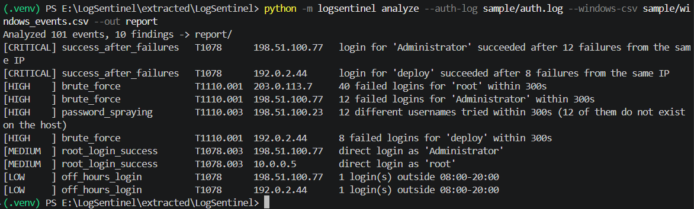
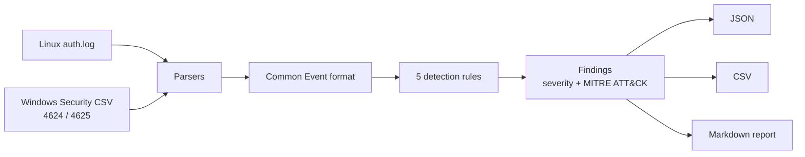
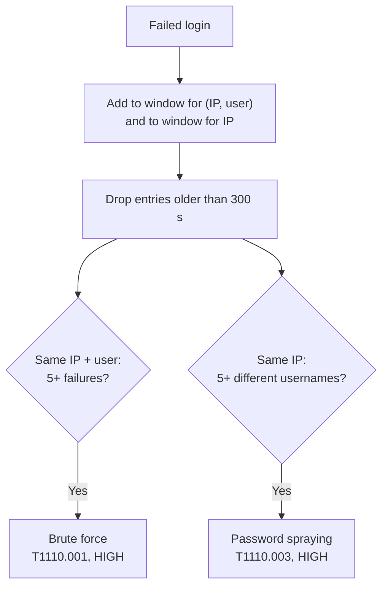

# LogSentinel

[](https://github.com/Shau-19/LogSentinel/actions/workflows/ci.yml)

A small Python tool that reads SSH (`auth.log`) and Windows logon events, detects common credential attacks, maps each finding to a MITRE ATT&CK technique and writes a report. Built to practice SOC-style log analysis and detection engineering.

Runs fully offline: no network calls and no external dependencies at runtime (standard library only), so it can be used on isolated or air-gapped machines.



## How it works



1. `parsers.py` turns raw lines into normalized `Event` objects, so every rule works on SSH and Windows data alike.
2. `rules.py` runs each detection. Burst rules use a sliding window (a deque) to find the densest window per source.
3. `report.py` writes the JSON, CSV and Markdown outputs, with a recommended action per rule.

## What it detects

| Rule | What it looks for | Severity | ATT&CK |
|---|---|---|---|
| `brute_force` | 5+ failed logins from one IP against one account inside 300 seconds | HIGH | T1110.001 Password Guessing |
| `password_spraying` | One IP failing against 5+ different usernames inside 300 seconds | HIGH | T1110.003 Password Spraying |
| `success_after_failures` | A successful login from an IP that just produced a burst of failures | CRITICAL | T1078 Valid Accounts |
| `root_login_success` | Direct login as `root` or `Administrator` | MEDIUM | T1078.003 Local Accounts |
| `off_hours_login` | Successful login outside 08:00 to 20:00 | LOW | T1078 Valid Accounts |

The threshold (`--threshold`) and window (`--window`) are command-line options. The other values are in the `Config` class in `logsentinel/rules.py`.

## Detection logic

Failed logins are kept in sliding time windows. Each new failure is added, failures older than the window are dropped, and a finding is raised when the count inside the window reaches the threshold.



`success_after_failures` works the other way round: for each successful login it counts the failures from the same IP in the 300 seconds before it.

## Quick start

```bash
git clone https://github.com/Shau-19/LogSentinel.git
cd LogSentinel

# analyze the bundled sample logs
python -m logsentinel analyze --auth-log sample/auth.log \
    --windows-csv sample/windows_events.csv --out report
```

Output goes to the `--out` folder: `report.md` (human readable), `findings.json` and `findings.csv`. See [docs/example_report.md](docs/example_report.md).

On the bundled sample (101 events) it reports 10 findings: 2 critical, 4 high, 2 medium and 2 low, including a 40-attempt brute force on `root`, spraying across 12 usernames and a login that succeeded after 8 failures. Normal staff logins from internal addresses are not flagged as attacks (checked in the test suite).

More commands:

```bash
# regenerate the synthetic sample logs
python -m logsentinel generate --out sample

# your own log, stricter thresholds
python -m logsentinel analyze --auth-log /var/log/auth.log --threshold 8 --window 120
```

## Inputs

**Linux `auth.log`:** `Failed password`, `Failed publickey` and `Accepted ...` sshd lines.

- The separate `Invalid user` lines are ignored so one attempt is not counted twice.
- `message repeated N times: [ Failed password ... ]` lines count as N attempts.
- Syslog lines carry no year. By default the year is inferred by assuming the log ends before the current date, and a jump back of more than 180 days between lines is treated as New Year. `--year` sets the year of the first line instead. Lines dated Feb 29 in a non-leap year are skipped.

**Windows:** CSV export of Security events 4624 (success) and 4625 (failure) with the columns `TimeCreated, EventID, TargetUserName, IpAddress`. Rows with no remote address are skipped. Also accepted:

- an `Id` column instead of `EventID`
- ISO dates and common local formats (`11/10/2026 3:00:00 AM`, `10/11/2026 03:00:00`, `10-11-2026 03:00:00`; month-first is tried before day-first)
- a plain `Get-WinEvent | Export-Csv` export: when `IpAddress` or `TargetUserName` is missing, they are read from the `Message` text (`Source Network Address:` and the last `Account Name:`)
- files saved with a UTF-8 byte order mark

This PowerShell command (run as Administrator) should export the events in the expected format. It has not yet been run on a live Windows machine, so check the output before relying on it:

```powershell
Get-WinEvent -FilterHashtable @{LogName='Security'; Id=4624,4625} | ForEach-Object {
  $d=@{}; ([xml]$_.ToXml()).Event.EventData.Data | ForEach-Object { $d[$_.Name]=$_.'#text' }
  [pscustomobject]@{ TimeCreated=$_.TimeCreated.ToString('s'); EventID=$_.Id
    TargetUserName=$d['TargetUserName']; IpAddress=$d['IpAddress'] }
} | Export-Csv events.csv -NoTypeInformation
```

## Tested on real data

LogSentinel was run on the public [Loghub](https://github.com/logpai/loghub) OpenSSH sample (`OpenSSH_2k.log`, 2,000 lines from an internet-facing server, about four hours on Dec 10):

```bash
mkdir -p data/loghub
curl -L -o data/loghub/OpenSSH_2k.log https://raw.githubusercontent.com/logpai/loghub/master/OpenSSH/OpenSSH_2k.log
python -m logsentinel analyze --auth-log data/loghub/OpenSSH_2k.log --out report/loghub
```

**Result:** 529 logon events, 15 HIGH findings (11 brute force, 4 password spraying) from 11 external IPs. The largest was 147 failed `root` logins from one IP inside five minutes. The one successful login in the sample (an ordinary user, from an IP with no failures, in the morning) was correctly not flagged.

Every finding was checked by hand against the raw log:

- **False positives:** none found. Every flagged IP is an external host repeatedly guessing passwords. The sample has only one successful login, so the success-based rules were barely exercised.
- **Gaps found and fixed:** the first run reported 13 findings. Two IPs had each made 6 failed `root` logins in about 13 seconds, but syslog had collapsed 5 of them into one `message repeated 5 times` line, which was counted once. One line with an empty username (`invalid user  0101`) was not parsed. The parser now handles both, with tests.
- **Still missed:** one IP tried a few usernames roughly once every 48 minutes. That is a deliberately slow attack that a 5-minute window cannot see.
- The log has no year. Run without `--year`, the report dates it relative to today, so the year shown is a guess.

The data is not included in this repository. Loghub datasets are free for research and academic use; please cite:

> Jieming Zhu, Shilin He, Pinjia He, Jinyang Liu, Michael R. Lyu. *Loghub: A Large Collection of System Log Datasets for AI-driven Log Analytics.* IEEE ISSRE, 2023. https://github.com/logpai/loghub

## Tests

```bash
pip install -r requirements-dev.txt
python -m pytest -q      # 33 tests: parsers, year handling, Windows formats, every rule (positive and negative cases), reports, end to end
```

GitHub Actions runs the tests on every push.

## Limitations

- The bundled sample data is synthetic, generated with a fixed seed using reserved documentation IP ranges. The Loghub run above covers one real log of about four hours, not a busy production environment.
- Thresholds are fixed values. A real deployment would need tuning per environment to control false positives (for example, shared NAT addresses or monitoring scripts that fail often).
- Slow attacks spread over hours are not detected by the 5-minute window.
- Batch analysis only. There is no live tailing, no alerting and no correlation across hosts, so this is a learning project and not a SIEM.
- Only sshd and Windows 4624/4625 events are supported.

## Ideas for next steps

- A long-window rule for slow attacks (for example, 10+ failures from one IP in 24 hours)
- GeoIP and known-bad IP enrichment
- Windows `.evtx` parsing without the CSV export step
- Per-account baselines for the off-hours rule
